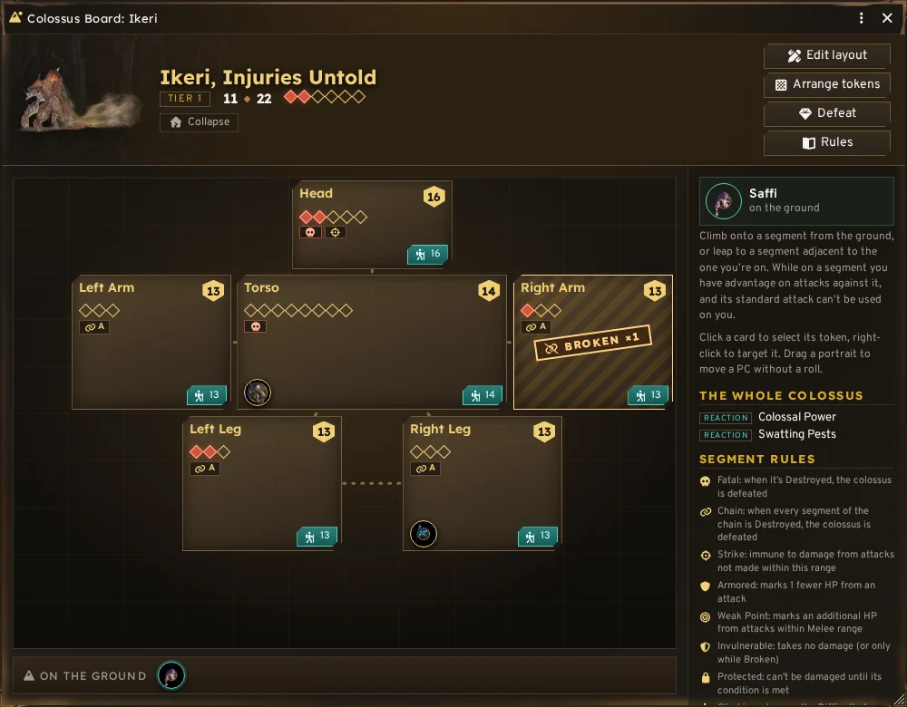
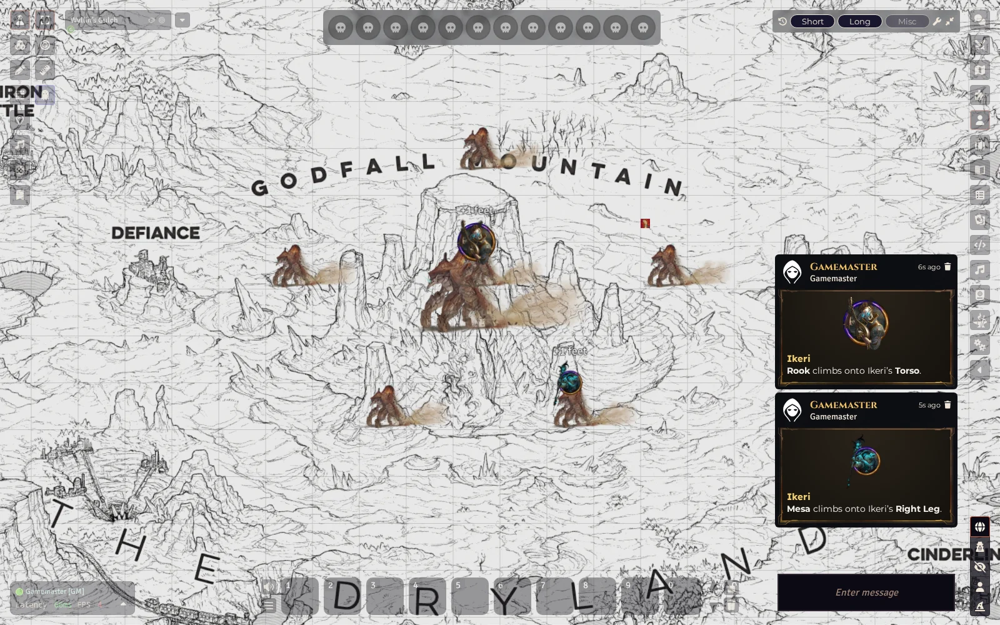
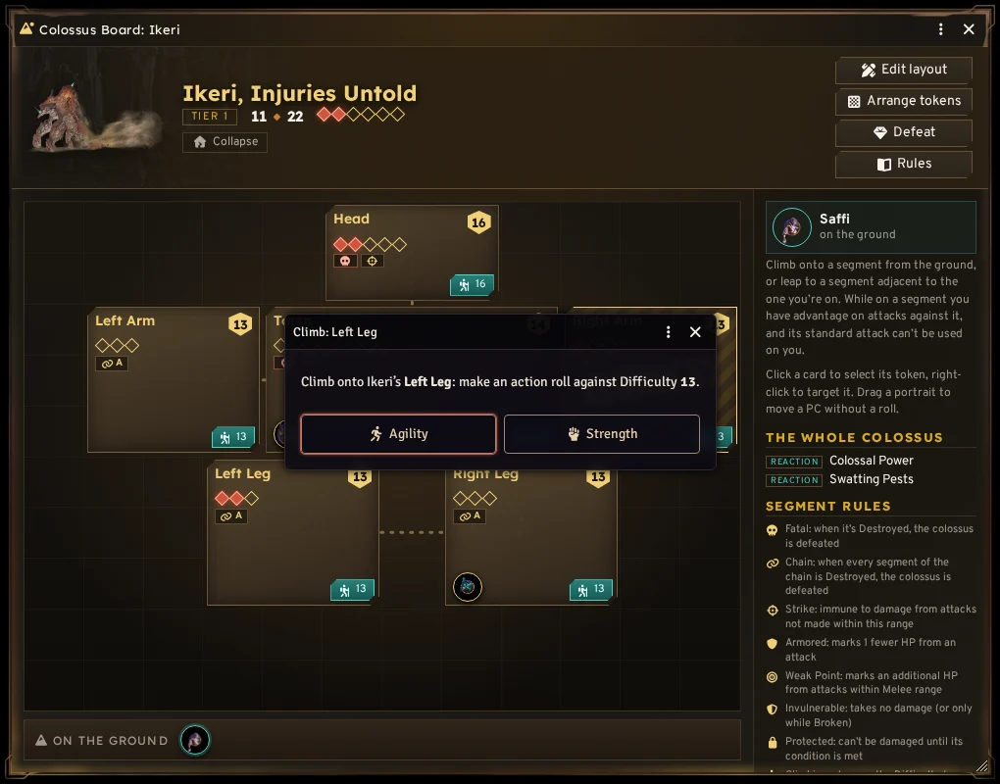
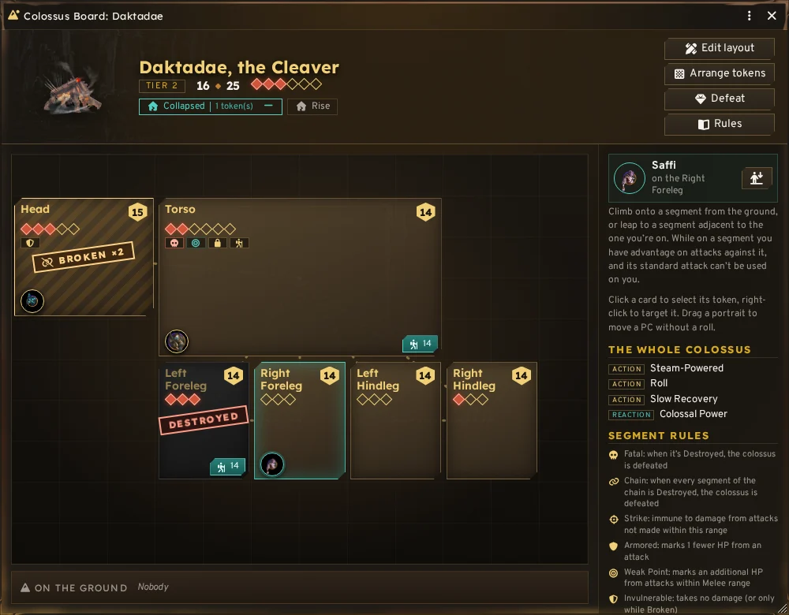
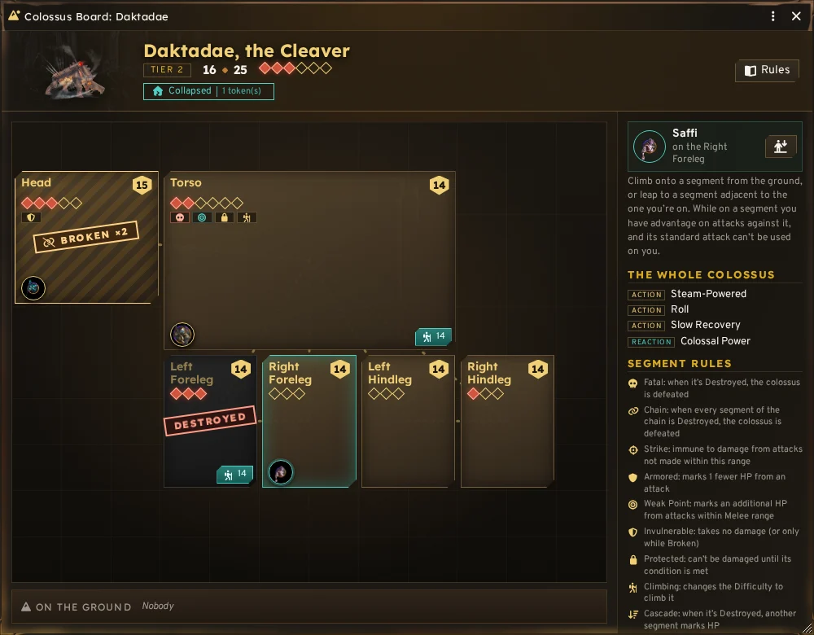
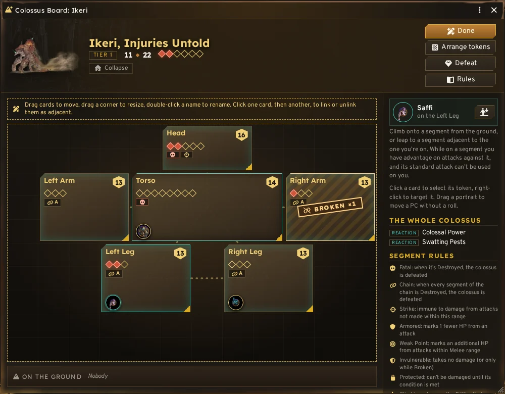
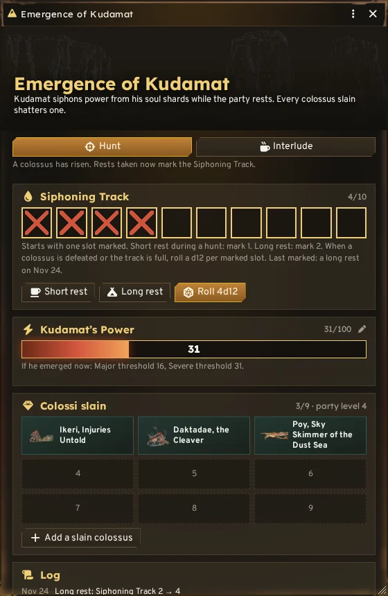
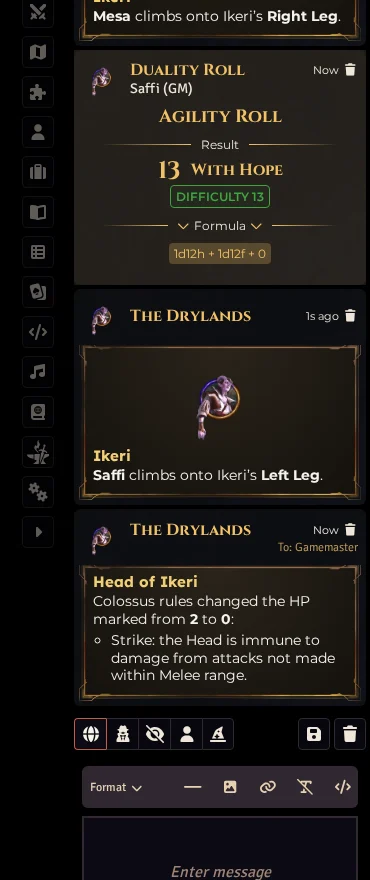

# Colossus: Colossus of the Drylands

A Foundry VTT module for running the **Colossus of the Drylands** campaign frame from the *Daggerheart Core Rulebook*. It builds on the Daggerheart system's colossus adversaries (a framework plus segment stat blocks) and adds what a colossus fight needs at the table: a live **Colossus Board** in the shape of the colossus, PCs climbing and leaping between segments, the segment rules automated, and the **Emergence of Kudamat** campaign tracker. It comes with the book's four example colossi, ready to drop on a scene.



## Requirements

- [**Foundry VTT**](https://foundryvtt.com/) v14
- [**Daggerheart**](https://foundryborne.online/) system **2.13.1** or later (the first version with colossus adversaries)
- [**Daggerheart Core Rulebook**](https://www.foundryvtt.store/products/daggerheart-core) module (`daggerheart-core`): provides the art of the colossi and the rulebook pages this module links to. Colossus doesn't include that art itself.
- Optional: [**Dice So Nice**](https://foundryvtt.com/packages/dice-so-nice) for 3D siphon rolls

Colossus can't be active together with Hotpot (`dh-hotpot`), Five Banners (`dh-5banners`), Horizon (`dh-horizon`) or Weredragon (`dh-weredragon`). Run one campaign frame module at a time.

## Installation

In Foundry's **Add-on Modules → Install Module**, paste this manifest URL:

```
https://github.com/emberite/dh-colossus/releases/latest/download/module.json
```

## Screenshots

| | |
|---|---|
|  |  |
| **On the canvas:** segment tokens arranged in Ikeri's shape around the framework token, with PCs riding the Torso and a Leg. | **Climbing:** an Agility or Strength Roll against the segment's Difficulty, with Climbing modifiers applied. |
|  |  |
| **Daktadae:** the Head Broken (2 tokens), a Foreleg Destroyed and the colossus Collapsed. | **The players' board:** leap only to segments adjacent to the one you're on. |
|  |  |
| **Edit layout (GM):** drag and resize cards, rename segments, click two cards to make them adjacent. | **Emergence of Kudamat:** hunts and interludes, the Siphoning Track, Kudamat's Power and the colossi slain. |
|  | |
| **Chat:** riders climbing on, and a GM-only card when a segment rule changes the HP marked. | |

## What the system does, and what this adds

The system (2.13+) has the colossus adversary type: a **framework** actor (Stress, thresholds, Experiences, whole-colossus features) and **part** actors for the segments. Placing a framework token places its segment tokens, scattered around it, and the segments share the framework's Stress and thresholds. Colossus builds on that:

| | System | Colossus |
|---|---|---|
| Segment tokens | dropped at random spots | arranged in the colossus's shape, named after their slot ("Left Leg", "Right Leg") |
| Overview | a list of parts on the sheet | the **Colossus Board**, the book's notecard map as a live window |
| PCs on the colossus | not tracked | climbing, leaping between adjacent segments, falling and being thrown off |
| Broken / Destroyed / Collapsed | not tracked | token counts, status icons, automation and chat cards |
| Segment rules | text only | Fatal, Chain, Strike, Armored, Weak Point, Invulnerable, Protected, Cascade, Climbing, Collapse automated |
| Defeat | not tracked | Fatal segments, chains or every segment Destroyed: the colossus falls |
| Campaign | — | Siphoning Track, Kudamat's Power, colossi slain and levels, building Kudamat |

## Features

### Colossi compendium

**Colossi of the Drylands** has the book's example colossi, each in its own folder as a framework actor and its segments, linked the way the system expects:

| Tier | Colossus | Segments |
|---|---|---|
| 1 | **Ikeri, Injuries Untold** | Head, Torso, 2 Arms, 2 Legs |
| 2 | **Daktadae, the Cleaver** | Head, Torso, 2 Forelegs, 2 Hindlegs |
| 3 | **Poy, Sky Skimmer of the Dust Sea** | Head, Neck, Body, 2 Talons, 2 Wings, Tail |
| 4 | **Kelir, the Virulent Hate & Her Hundred, Hundred Children** | Head, Shell, Body Cavity, 2 Claws, 4 Legs |

Drag the framework onto a scene: the system places its segments and Colossus arranges them. Every segment knows its adjacent segments, whether it can be reached from the ground and where its card goes on the board. The art comes from the Core Rulebook module. The framework's Difficulty is the highest among its segments, for effects that target the colossus as a whole.

**Colossus Features** has the book's example features (Fatal, Chain, Strike, Armored, Climbing, Not Climbable, Weak Point, Shake Off, Kudamat's Rage, Swatting Pests, Collapsed, Colossal Power) to drop onto your own colossi.

### The Colossus Board

Open it from the **Colossus of the Drylands** section of the Daggerheart sidebar menu, the mountain button in the token controls (while a colossus is on the scene), the token HUD of a colossus token, the colossus section of its sheet, or with `game.modules.get('dh-colossus').api.openBoard()`.

Every segment is a card in the shape of the colossus, with dotted lines between adjacent segments. A card shows the segment's HP (the GM clicks to mark them), its Difficulty, its rules as badges, **Broken** tokens, **Destroyed**, and the PCs riding it. The header has the colossus's tier, thresholds and shared Stress, and its states: **Flying**, **Collapsed** (with tokens, or permanently) and **Defeated**. The side panel lists the whole-colossus features (click to use them) and what the badges mean.

- **Players** see their character on the board. **Climb** onto a segment from the ground, or **leap** to one adjacent to the segment you're on: an Agility or Strength Roll against the segment's Difficulty (+ Climbing, + Poy's Flying bonus from the ground). Segments high above the ground can only be reached once the colossus is Collapsed. A climb from a player goes through the GM, so a GM needs to be connected.
- **The GM** clicks a card to select the token (right-click targets it), places and clears Broken tokens, uses the segment's standard attack, drags PC portraits between cards without a roll, collapses or raises the colossus, arranges the tokens and marks it defeated.
- **Edit layout:** drag cards, resize them from the corner, double-click a name to rename the segment, click two cards to make them adjacent (or not), and toggle ground access. The layout is saved on the segment actors, so it works for colossi you build yourself. Segments without a layout are laid out in rows.

### Rules automation

All of it can be switched off in the settings.

- **Damage to segments.** When a segment takes damage, its rules apply and the GM gets a whisper explaining what changed:
  - **Strike (Melee)**: no damage from attacks not made within that range (a PC on the segment counts as Melee; otherwise the weapon's range is used);
  - **Armored**: 1 fewer HP; **Weak Point**: 1 more HP within Melee range (with the book's conditions, like Daktadae's "while the Head is Broken or Destroyed");
  - **Invulnerable** (or only while Broken), **Protected** (until another segment is Broken or Destroyed, or only by Cascade) and segments with no HP take no damage.
- **Destroyed.** A segment that marks its last HP is Destroyed (status icon and chat card). **Cascade** makes another segment mark HP.
- **Collapse.** A segment's Collapse feature collapses the colossus: when all Legs are marked, when a Leg is Destroyed (a token, permanently when both are), or when three Legs are Destroyed.
- **Defeat.** A **Fatal** segment Destroyed, every segment in a **Chain** Destroyed, or every segment Destroyed: the colossus is defeated and the card offers to **shatter the soul shard**.
- **Acting.** Broken segments can't use actions or reactions, Destroyed segments can't use features, a segment's standard attack can't target a PC riding it, and Kelir's Destructive Scuttle can't be used while she's Collapsed.
- **Riding.** A PC on a segment has advantage on attacks against it. **Roll** throws every rider off Daktadae; **Shake Off** lets the GM pick who falls. Falling off a flying Poy shows the fall damage.
- **Broken tokens.** Daktadae's Head Toss and Cleaver Recovery place their tokens; Slow Recovery is a click on the board.
- **Conditions.** Broken, Destroyed and Collapsed are token statuses, as are **Shaken** (no Hope from the next roll with Hope, which clears it), **Rattled** (disadvantage on reaction rolls until a roll with Hope) and **Trapped**. An action roll in Kelir's Body Cavity marks a Stress (Protective Swarm).

The rules come from the segment's features, read by name the way the book writes them ("Chain (B)", "Strike (Very Close)", "Climbing (−2)"), so colossi you build with the book's example features are automated too.

### Emergence of Kudamat

Open it from the sidebar menu or with `api.openDrylands()`.

- **Hunt or interlude.** During a hunt, a **short rest** marks the Siphoning Track once and a **long rest** twice. Rests are picked up from the system's rest cards; every PC posts one, so rests of the same kind close together count once.
- **The siphon.** When a colossus is defeated or the track is full, roll a d12 per marked slot (in 3D with Dice So Nice), add the highest to **Kudamat's Power** and reset the track to 1.
- **Colossi slain.** Shattering a soul shard records the colossus, tells the table the PCs level up and rolls the siphon.
- **Kudamat emerges** when nine colossi are slain or his Power reaches 100: **Build Kudamat** creates him as a colossus framework with Severe threshold = Power and Major = half of it (rounded up), ready for his segments.

### Settings

Segment damage rules, Broken/Destroyed segments can't act, advantage while riding, Collapse automatically, roll to climb, move PC tokens onto segments, arrange segment tokens (and the scale), the Shaken/Rattled/Trapped conditions, the Emergence of Kudamat, rests marking the track, the rest window, and whether players see Kudamat's Power.

### API

```js
const colossus = game.modules.get('dh-colossus').api;
colossus.openBoard(token);            // a framework token, or the first colossus on the scene
colossus.colossi();                   // every colossus on the scene, with its segments and riders
colossus.climb(actor, frameworkToken, segmentTokenId);
colossus.setRider(frameworkToken, actorUuid, segmentTokenId | null);
colossus.setBroken(segmentToken, 2);
colossus.setCollapsed(frameworkToken, { permanent: true });
colossus.arrange(frameworkToken);
colossus.markRest('long'); colossus.rollSiphon(); colossus.shatter({ name: 'Ikeri' });
```

## Development

```
npm install
npm test            # rules tests (node:test), run against the compendium data
npm run build       # data/packs.mjs → src/*.json → packs/ (LevelDB)
```

Publishing a GitHub release with a tag like `v0.2.0` runs the tests, stamps the version into `module.json`, and attaches `module.json` and `module.zip` to the release.

## License

The Colossus module (its code, templates, styles and original content) is released under the [MIT License](LICENSE). © 2026 emberite.

The MIT License doesn't cover Daggerheart material. The Colossus of the Drylands campaign frame, its colossi and their features are from the *Daggerheart Core Rulebook* by Darrington Press. The [Daggerheart Core Rulebook](https://www.foundryvtt.store/products/daggerheart-core) module's art and rulebook pages are loaded from that module at runtime and are not included in this repository; the screenshots show it in use.

This product includes materials from the
Daggerheart System Reference Document
2.0, © Critical Role, LLC. under the terms of
the Darrington Press Community Gaming
(DPCGL) License. More information can be
found at
https://www.daggerheart.com. There are
no previous modifications by others.
